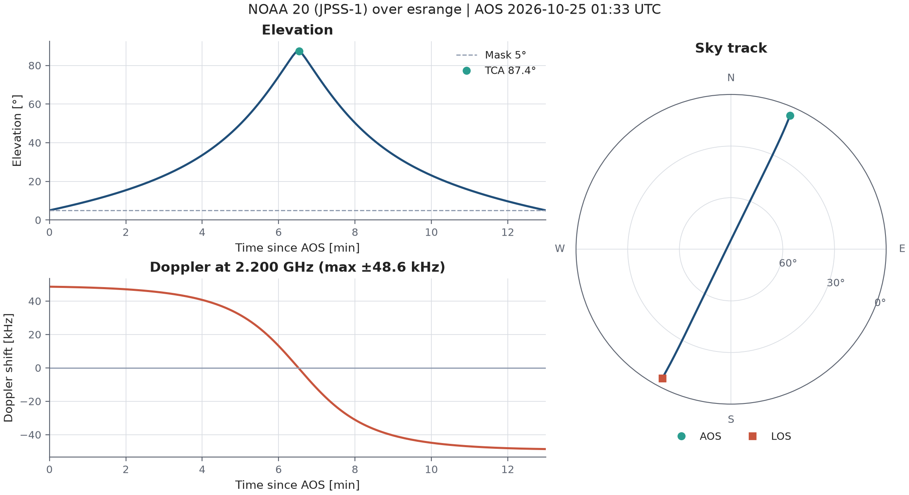

# Ground Pass API

Predicts when a satellite is visible from a ground station and what the
link geometry looks like during the pass: AOS, TCA and LOS, elevation and
azimuth, slant range, and Doppler shift on the downlink. A small FastAPI
service exposes it over REST.

Orbits are propagated with SGP4 (via [skyfield](https://rhodesmill.org/skyfield/))
from public TLEs fetched from [CelesTrak](https://celestrak.org).



## Why

Ground station networks sold as a service schedule customer passes
through an API. This is a small version of the piece that comes first:
working out when the passes are and what the antenna and receiver have
to do during them (where to point, how fast to slew, how far the carrier
moves).

It is a learning project, not an operational tool. See
[Limitations](#limitations).

## Quick start

Requires [conda](https://docs.conda.io/) (Miniconda or Anaconda).

```bash
conda env create -f environment.yml
conda activate ground-pass-api
pytest
```

Run the API:

```bash
uvicorn groundpass.api:app --reload
```

Interactive docs: <http://127.0.0.1:8000/docs>

Generate the figures and print upcoming passes:

```bash
python scripts/make_figures.py                      # NOAA-20 over Esrange
python scripts/make_figures.py --norad-id 25544 --station south_point
```

Regenerate the example API responses in `docs/examples/`:

```bash
python scripts/make_examples.py
```

## API

| Method | Path                | Returns                                         |
|--------|---------------------|-------------------------------------------------|
| GET    | `/health`           | Service status                                  |
| GET    | `/stations`         | Known ground stations                           |
| GET    | `/passes`           | Passes of one satellite over one station        |
| GET    | `/passes/{pass_id}` | Elevation, azimuth, range and Doppler over time |

List the next 24 h of NOAA-20 passes over Esrange:

```bash
curl "http://127.0.0.1:8000/passes?norad_id=43013&station=esrange"
```

```json
[
  {
    "pass_id": "43013-esrange-20261025T013949Z",
    "norad_id": 43013,
    "satellite_name": "NOAA 20 (JPSS-1)",
    "station": "esrange",
    "aos": "2026-10-25T01:33:18.247983Z",
    "tca": "2026-10-25T01:39:49.150590Z",
    "los": "2026-10-25T01:46:17.855302Z",
    "duration_s": 779.6,
    "max_elevation_deg": 87.53,
    "min_elevation_deg": 5.0
  },
  ...
]
```

Detail of that pass, S-band downlink, sampled every 10 s:

```bash
curl "http://127.0.0.1:8000/passes/43013-esrange-20261025T013949Z?downlink_hz=2.2e9&step_s=10"
```

```json
{
  "summary": { "pass_id": "43013-esrange-20261025T013949Z", ... },
  "downlink_hz": 2200000000.0,
  "step_s": 10.0,
  "max_doppler_hz": 48634.0,
  "max_azimuth_rate_deg_s": 11.941,
  "samples": [
    {
      "time": "2026-10-25T01:33:18.294573Z",
      "elevation_deg": 5.004,
      "azimuth_deg": 23.717,
      "range_km": 2871.342,
      "range_rate_km_s": -6.62065,
      "doppler_hz": 48585.0
    },
    ...
  ]
}
```

Full responses: [`docs/examples/`](docs/examples/). The pass in these
examples is the one plotted at the top of this page.

Query parameters for `/passes`: `norad_id` (required), `station`
(default `esrange`), `hours` (default 24, max 168), `min_elevation_deg`
(default 5), `start` (ISO 8601, default now).

Query parameters for `/passes/{pass_id}`: `downlink_hz` (default 2.2e9),
`step_s` (default 5), `min_elevation_deg` (default 5).

## Docker

```bash
docker build -t ground-pass-api .
docker run --rm -p 8000:8000 ground-pass-api
```

## Design notes

**Doppler.** One-way, first order: `Δf = −f₀ · ṙ / c`, where `ṙ` is the
range rate (positive when the satellite moves away). The relativistic
term is about 5 × 10⁻¹⁰ for LEO, roughly 1 Hz at S-band, and is ignored.
Doppler scales with carrier frequency, so a LEO pass that moves an S-band
carrier by about ±50 kHz moves an X-band carrier by about ±180 kHz.

**Pass ids from TCA.** A pass id is `{norad_id}-{station}-{TCA}`. TCA does
not depend on the elevation mask, while AOS and LOS do, so the same
physical pass keeps the same id whatever mask the client asks for. The
service is stateless: the detail endpoint recomputes the pass from the
id.

**Azimuth rate.** Each pass detail reports the peak azimuth rate. On a
near-overhead pass this rises sharply as the satellite crosses close to
zenith, which is the "keyhole" problem for az-el antenna mounts. On the
87.5° example pass the antenna has to turn 11.9 °/s in azimuth at TCA,
swinging through about 90° of azimuth in the ten seconds around it.

The peak is narrow, so fixed-step sampling misses it: at a 10 s step the
largest sampled rate on that pass was only 7.1 °/s. The peak is
therefore also evaluated exactly at TCA, and a test checks that the
reported value does not depend on the sampling step.

**TLE cache.** TLEs are cached on disk for 6 hours, which is plenty given
how often CelesTrak updates them. If CelesTrak cannot be reached, a stale
cached copy is used. Set `GROUNDPASS_TLE_FILE` to serve from a local file
instead.

## Validation

- The pass finder reproduces the ISS pass times published in skyfield's
  documentation to within 2 s (`tests/test_passes.py`).
- Physical checks in the tests: AOS < TCA < LOS, minimum range at
  maximum elevation, Doppler sign change across TCA, Doppler magnitude
  bounded by orbital velocity.
- Live comparison against [Heavens-Above](https://www.heavens-above.com)
  for NOAA-20 over Esrange, 24–25 October 2026: all 10 passes in the
  overlapping window match. TCA agrees to within 1.2 s, and maximum
  elevation agrees exactly after rounding to Heavens-Above's whole
  degrees.

| TCA, this API (UTC)  | TCA, Heavens-Above | Δt     | Max el, this API | Heavens-Above |
|----------------------|--------------------|--------|------------------|---------------|
| 24 Oct 11:55:44.9    | 11:55:44           | +0.9 s | 41.7°            | 42°           |
| 24 Oct 13:37:27.7    | 13:37:27           | +0.7 s | 14.8°            | 15°           |
| 24 Oct 22:17:01.9    | 22:17:01           | +0.9 s | 11.8°            | 12°           |
| 24 Oct 23:58:59.1    | 23:58:58           | +1.1 s | 33.8°            | 34°           |
| 25 Oct 01:39:49.1    | 01:39:48           | +1.1 s | 87.5°            | 88°           |
| 25 Oct 03:19:42.7    | 03:19:42           | +0.7 s | 38.1°            | 38°           |
| 25 Oct 04:58:54.1    | 04:58:53           | +1.1 s | 23.4°            | 23°           |
| 25 Oct 06:37:46.4    | 06:37:46           | +0.4 s | 21.5°            | 21°           |
| 25 Oct 08:16:47.3    | 08:16:47           | +0.3 s | 30.1°            | 30°           |
| 25 Oct 09:56:22.4    | 09:56:22           | +0.4 s | 61.9°            | 62°           |

Heavens-Above lists times to the whole second, and the difference is
always positive and under 1.2 s, which fits it truncating rather than
rounding. The two tools may also use TLEs from slightly different
epochs. Only TCA and maximum elevation are compared because AOS and LOS
depend on the elevation mask, which is 10° on Heavens-Above and 5° here.

## Limitations

- SGP4 from TLEs is accurate to around a kilometre near epoch and gets
  worse with TLE age. Fine for scheduling and pointing estimates, not for
  precise orbit determination.
- No atmospheric refraction, which matters a little at very low
  elevation.
- No antenna model: no slew or acceleration limits, no local horizon
  mask, no keyhole handling beyond reporting the azimuth rate.
- Station coordinates are approximate public figures.
- The detail endpoint searches one hour either side of TCA, which assumes
  LEO.

## Project layout

```
src/groundpass/
    stations.py        ground station definitions
    tle.py             TLE parsing, CelesTrak fetch and cache
    passes.py          pass finding and pass detail
    doppler.py         Doppler shift
    api.py             FastAPI service
    plotting/
        style.py       style guide: every colour, font and size lives here
        figures.py     elevation, Doppler and sky-track plots
scripts/
    make_figures.py    README figures
    make_examples.py   example API responses in docs/examples/
tests/
```

## Plot style

All figures take their look from `src/groundpass/plotting/style.py`.
Change a colour, font, figure size or the export format there and
re-run `scripts/make_figures.py`. Set `EXPORT["format"] = "pdf"` for
figures going into LaTeX.

## Development

Code follows PEP 8 (79-character lines), checked with ruff:

```bash
ruff check .
ruff format .
```
